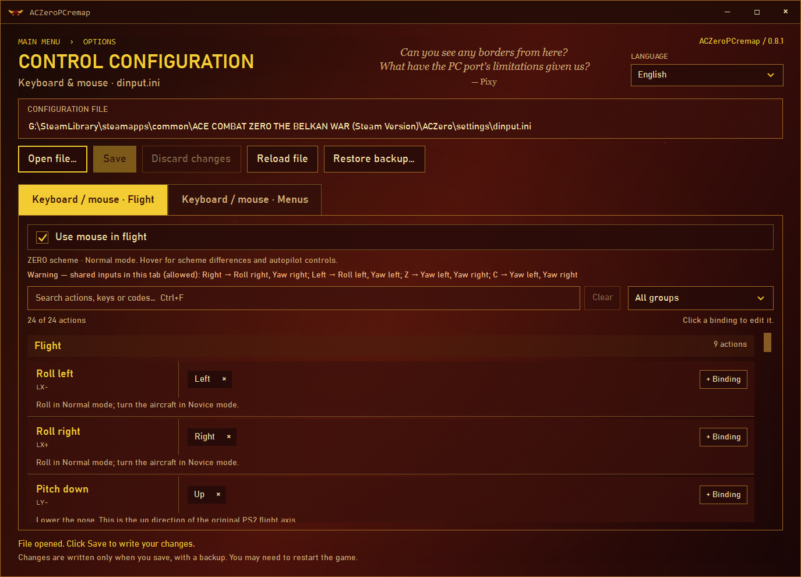

# ACZeroPCremap

A portable control remapper for the **Ace Combat Zero PC port**, with an interface inspired by the game's menus.

**Windows 10/11 x64 · No installation · .NET included**



## Features

- Keyboard and mouse bindings.
- Mouse movement and wheel capture.
- Separate flight and menu controls, with search and action groups.
- Automatic backups and restore.
- English, Russian, Spanish, Brazilian Portuguese, German and French.

## Getting started

Launch the game at least once to generate its INI configuration files.

1. Download the **win-x64 ZIP** from **Releases** and extract it.
2. Launch **ACZeroPCremap.exe** and open your game's `dinput.ini`:

   ```text
   ACE COMBAT ZERO THE BELKAN WAR (Steam Version)\ACZero\settings
   ```

3. Set your bindings and click **Save**. Restart the game if needed.

## Development

Built with C#, .NET 10 and WPF. See [contributing](CONTRIBUTING.md) for builds and checks, or the [user guide](docs/USER-GUIDE.md) for details.

## License

[MIT](LICENSE). Unofficial project, not affiliated with the game's publisher.
